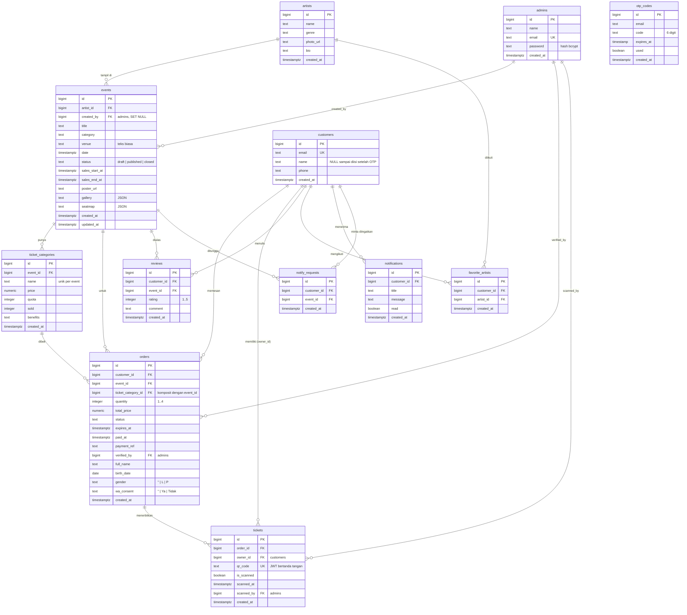

# Wavy — Database (skema v2)

> Sumber kebenaran: `wavy-backend/db/migrations/*.sql` (saat ini `001_init.sql`). Dokumen ini ringkasan untuk dibaca;
> kalau berbeda, file migration yang benar. Postgres (NeonDB di produksi, Postgres lokal `*_test` untuk test & e2e).

## 1. Prinsip

- Tanpa ORM. SQL mentah lewat postgres-js; skema dibangun dari file migration bernomor, dicatat di `schema_migrations`.
- File migration yang sudah di-merge **tidak pernah diedit**. Perubahan = file baru `002_...sql`, `003_...sql`.
- Id: `bigint GENERATED BY DEFAULT AS IDENTITY`. Waktu: `timestamptz` (kecuali `otp_codes.expires_at`, `timestamp` yang dibandingkan dengan `LOCALTIMESTAMP`).
- Semua relasi pakai **FOREIGN KEY**; nilai terbatas dipaksa **CHECK**; kolom wajib `NOT NULL` (teks opsional = `''`, bukan NULL).
- Nama kolom yang tampil di respons API (`date`, `is_scanned`, `read`, `password`, `wa_consent`) sama dengan skema lama, supaya web & mobile tidak ikut berubah.

## 2. ERD

Kolom lengkap ada di §3. Diagram hanya menampilkan kolom utama.

## 3. Tabel

### Akun

| Tabel | Kolom | Constraint |
|---|---|---|
| `admins` | `id`, `name`, `email`, `password` (bcrypt cost 10), `created_at` | `email` UNIQUE + harus berisi `@`; `name` tidak boleh kosong. Dibuat lewat `scripts/create-admin.ts` |
| `customers` | `id`, `email`, `name`, `phone`, `created_at` | `email` UNIQUE; `name` NULL atau ≤ 80 karakter (NULL = akun baru, `needs_name`); `phone` ≤ 30 |
| `otp_codes` | `id`, `email`, `code`, `expires_at`, `used`, `created_at` | `code` 6 digit; index `(email, code)`; maks 3 permintaan per email per 5 menit (service) |

### Katalog (milik platform)

| Tabel | Kolom | Constraint |
|---|---|---|
| `artists` | `id`, `name`, `genre`, `photo_url`, `bio`, `created_at` | `name` tidak kosong. Tidak bisa dihapus selama dipakai event (`RESTRICT`) |
| `events` | `id`, `artist_id`, `created_by`, `title`, `category`, `venue`, `date`, `poster_url`, `banner_url`, `description`, `terms_conditions`, `gallery`, `seatmap`, `status`, `sales_start_at`, `sales_end_at`, `created_at`, `updated_at` | `artist_id` FK `RESTRICT`; `created_by` FK admins `SET NULL`; `status IN ('draft','published','closed')`; `sales_end_at > sales_start_at`; `sales_end_at <= date`; `sales_start_at < date` |
| `ticket_categories` | `id`, `event_id`, `name`, `price`, `quota`, `sold`, `benefits`, `created_at` | `event_id` FK `CASCADE`; `UNIQUE (event_id, name)`; `UNIQUE (id, event_id)` (target FK komposit); `price >= 0`, `quota > 0`, `sold >= 0` |

### Transaksi

| Tabel | Kolom | Constraint |
|---|---|---|
| `orders` | `id`, `customer_id`, `event_id`, `ticket_category_id`, `quantity`, `total_price`, `status`, `expires_at`, `created_at`, `paid_at`, `payment_ref`, `payment_type`, `verified_by`, data pemesan (`full_name`, `email`, `phone`, `id_number`, `birth_date`, `gender`, `wa_consent`) | FK customer/event `RESTRICT`; **FK komposit `(ticket_category_id, event_id) → ticket_categories(id, event_id)`** (kategori pasti milik event order); `quantity BETWEEN 1 AND 4`; `status IN ('pending_payment','paid','expired','rejected','refunded','cancelled')`; pending wajib punya `expires_at`; paid wajib punya `paid_at`; `gender IN ('','L','P')`; `wa_consent IN ('','Ya','Tidak')`; `verified_by` FK admins `SET NULL` |
| `tickets` | `id`, `order_id`, `owner_id`, `qr_code`, `is_scanned`, `scanned_at`, `scanned_by`, `created_at` | `order_id` FK `CASCADE`; `owner_id` FK customers (berubah saat transfer); `qr_code` UNIQUE; `scanned_by` FK admins `SET NULL` |

Status `cancelled` disiapkan di skema dan dihitung di dashboard admin, tetapi belum ada alur yang mengisinya.

### Interaksi customer

| Tabel | Constraint |
|---|---|
| `reviews` | `UNIQUE (customer_id, event_id)`, `rating BETWEEN 1 AND 5`, FK `CASCADE` |
| `favorite_artists` | `UNIQUE (customer_id, artist_id)`, FK `CASCADE` |
| `notify_requests` | `UNIQUE (customer_id, event_id)`, FK `CASCADE` ("ingatkan saya" saat penjualan dibuka) |
| `notifications` | FK `CASCADE`; index `(customer_id, created_at DESC)` |

## 4. Aturan bisnis yang menyentuh database (PRD §4)

- **Kuota terpakai** = `ticket_categories.sold` (order paid) + jumlah `quantity` order `pending_payment` yang `expires_at > now()`. `POST /orders` mengunci baris kategori (`SELECT ... FOR UPDATE`) sebelum menghitung dan menyimpan, dalam satu transaksi.
- **Lazy expiry:** order pending yang lewat `expires_at` diubah ke `expired` saat dibaca (daftar order, dashboard, checkout); tidak ada cron.
- **Paid:** webhook Midtrans atau verifikasi admin → `status = 'paid'`, `paid_at`, `sold += quantity`, tiket + QR terbit (satu transaksi).
- **Refund:** `paid → refunded`, `sold -= quantity`.
- **Scan:** `is_scanned = true`, `scanned_at`, `scanned_by`; scan kedua ditolak `ALREADY_SCANNED`.

## 5. Migrasi, reset, dan data demo

| Script (`wavy-backend/scripts`) | Fungsi |
|---|---|
| `migrate.ts` | Terapkan migration yang belum tercatat di `schema_migrations` (`--status` untuk melihat saja) |
| `db-reset.ts` | Dry-run tanpa argumen. `--confirm=<nama-db>`: simpan admin (+ `backup/admins-*.json`) → `DROP SCHEMA public CASCADE` → jalankan migration → kembalikan admin, semua dalam satu transaksi |
| `seed-demo-v2.ts` | Data demo **fiktif** (artis, konser, kategori, order). Dry-run tanpa argumen, tulis dengan `--confirm=<nama-db>`; tidak pernah otomatis |
| `create-admin.ts` | Buat admin atau ganti password admin |

Test (`bun test`) dan e2e memakai migration yang sama di Postgres lokal bernama `*_test`; tidak pernah ke Neon.

## 6. Dihapus dari skema v1

`organizers`, `favorite_organizers`, `waiting_room`, `waiting_list`; kolom `events.organizer_id`, `artists.organizer_id`.
Ditunda (bukan bagian v2): `venues`, `venue_sections`, `category_sections`, `orders.venue_section_id` (`docs/PLAN-v2.md` §7).
