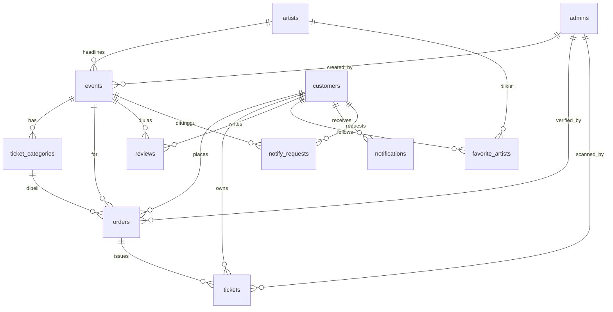

# Wavy v2 — Rencana

> Status: **disetujui Kalsah 2026-11-27, direvisi 2026-11-28** — fitur venue & pemilih section (3D/2D) **ditunda** (§7).
> Dasar: `docs/PRD.md`, `docs/DESIGN.md`, `docs/AUDIT.md`, kode di `origin/main` ketiga repo.
> Skema final ada di `docs/DATABASE.md` (dibuat di branch `docs/prd-v2`).

## 0. Ringkasan perubahan

| Sebelum | Sesudah (v2) |
|---|---|
| 3 role: customer, organizer (EO), admin | 2 role: **admin** (web) dan **customer** (web + mobile) |
| Event & artis milik EO (`organizer_id`) | Event & artis milik platform, dikelola admin |
| Creator Studio `/organizer/*` (login EO terpisah) | Portal admin `/admin/*` (satu login admin) berisi semua fitur Creator Studio |
| Daftar customer terpisah (`/auth/register`, layar Daftar mobile) | Satu alur email → OTP → (akun baru) isi nama |
| Data scrape Loket di DB & repo | DB dikosongkan kecuali admin; script scrape & data dihapus |
| Skema DB tidak ada di repo (snapshot test + migration TS parsial) | `db/migrations/*.sql` bernomor = satu sumber skema (produksi & test) |
| `orders`, `tickets`, `events`, `artists` tanpa FOREIGN KEY | Semua relasi FK + CHECK + NOT NULL |

Tetap: order per **kategori tiket** (tanpa section), `events.venue` teks biasa, Midtrans Snap + verifikasi manual admin, review, favorit artis, notifikasi, notify-me, transfer tiket, level customer, scan QR & refund (pindah ke admin), aturan PRD §4 (status penjualan dihitung, anti-oversell dengan row lock, lazy expiry 15 menit).

---

## 1. Skema database

### 1.1 Prinsip
- Semua relasi pakai **FOREIGN KEY**; nilai terbatas dipaksa **CHECK**; kolom wajib `NOT NULL`.
- Id: `bigint GENERATED BY DEFAULT AS IDENTITY`. Waktu: `timestamptz` (kecuali `otp_codes.expires_at` yang dibandingkan dengan `LOCALTIMESTAMP`, sama seperti sekarang).
- **Nama kolom yang tampil di respons API dipertahankan** (`date`, `is_scanned`, `read`, `password`, `wa_consent`), supaya web & mobile tidak ikut berubah. Revisi dari rencana awal yang mengganti nama kolom.
- Tanpa ORM; SQL di `wavy-backend/db/migrations/NNN_nama.sql`, dijalankan `scripts/migrate.ts` (dicatat di `schema_migrations`).

### 1.2 ERD

Kolom lengkap: `docs/DATABASE.md`.

### 1.3 Constraint penting

| Tabel | Constraint |
|---|---|
| `customers` | `UNIQUE email`; `name` NULL sampai diisi setelah OTP (`needs_name`) |
| `events` | `artist_id` FK `RESTRICT`; `created_by` FK admins `SET NULL`; `CHECK status IN ('draft','published','closed')`; `sales_end_at > sales_start_at`, `sales_end_at <= date`, `sales_start_at < date` |
| `ticket_categories` | `event_id` FK `CASCADE`; `UNIQUE (event_id, name)`; `UNIQUE (id, event_id)`; `price >= 0`, `quota > 0`, `sold >= 0` |
| `orders` | FK customer/event/kategori `RESTRICT`; **FK komposit `(ticket_category_id, event_id) → ticket_categories(id, event_id)`** (kategori pasti milik event order); `CHECK quantity BETWEEN 1 AND 4`; `CHECK status IN ('pending_payment','paid','expired','rejected','refunded','cancelled')`; `gender IN ('','L','P')`, `wa_consent IN ('','Ya','Tidak')`; `verified_by` FK admins |
| `tickets` | `order_id` FK `CASCADE`; `owner_id` FK customers; `UNIQUE qr_code`; `scanned_at`, `scanned_by` (baru) |
| `reviews` | `UNIQUE (customer_id, event_id)`, `rating BETWEEN 1 AND 5` |
| `favorite_artists`, `notify_requests` | `UNIQUE` pasangan, FK `CASCADE` |

### 1.4 Dihapus / diubah dari skema sekarang

| Tabel / kolom | Nasib |
|---|---|
| `organizers`, `favorite_organizers`, `waiting_room`, `waiting_list` | **Hapus** |
| `events.organizer_id`, `artists.organizer_id` | Hapus; `events.created_by` (admin) baru |
| `events.venue`, `events.seatmap` | **Tetap** (teks biasa) |
| `orders.verified_by`, `tickets.scanned_at`, `tickets.scanned_by`, `customers.phone`, `created_at` di artis/kategori/event | Baru |

### 1.5 Migrasi
DB dikosongkan, jadi migrasi = **reset**: `scripts/db-reset.ts` (§5) menyimpan admin → `DROP SCHEMA public CASCADE` → jalankan `db/migrations/*.sql` → kembalikan admin, semua dalam satu transaksi. Test (`bun test`) memakai migration yang sama; `tests/fixtures/schema.sql` dan `src/db/migrations/*.ts` dihapus.

### 1.6 Penghapusan data scrape & script Loket
**wavy-backend/scripts — dihapus:** `_apply-manual.ts`, `_apply-tnc.ts`, `_manual-tnc/`, `_new-events.json`, `_scrape-tnc.ts`, `_slugs-all.json`, `_tnc.json`, `add-hotels-extra.ts`, `add-more-events.ts`, `add-organizer-profile.ts`, `generate-add-events-sql.ts`, `scrape-loket-hotels.ts`, `seed-scraped.sql`, `seed-scraped.ts`, `strip-loket.ts`, `strip-loket-neon.sql`, `upload-hotel-images.ts`, `verify-data.ts`, `seed-demo.ts`, `seed-admin.ts`, `migrate-*.ts`; juga `tests/strip-loket.test.ts`. **Tetap:** `create-admin.ts`. **Baru:** `migrate.ts`, `db-reset.ts`, `seed-demo-v2.ts`.
**wavy-next — dihapus:** `src/data/hotels.json`, `/hotels/[id]`, traveler mode.
Riwayat git & aset Cloudinary dibiarkan.

---

## 2. Endpoint

### 2.1 Dihapus
`POST /auth/organizer/login|register|verify-email`, `POST /auth/register`, semua `/organizer/*` (pindah, §2.2), `GET|PATCH /admin/organizers*`, `POST|DELETE /favorites/organizers/:id`, `/concerts/:id/waiting-room`, `/concerts/:id/waiting-list`, field `organizers` di `/homepage` dan `organizer_name` di respons konser/order. Middleware `organizerAuth` & klaim JWT `organizer_id` dihapus.

### 2.2 Dipindah ke `/admin` (semua `adminAuth`)

| Lama | Baru |
|---|---|
| `GET|POST /organizer/events`, `GET|PUT|DELETE /organizer/events/:id` | `/admin/events`, `/admin/events/:id` (menggantikan `GET /admin/events` read-only lama) |
| `POST /organizer/events/:id/publish`, `/close-sales` | `/admin/events/:id/publish`, `/admin/events/:id/close-sales` |
| — | **`POST /admin/events/:id/reopen-sales`** (baru: `closed` → `published`; status penjualan tetap dihitung dari tenggat & kuota) |
| `GET|POST /organizer/events/:id/ticket-categories`, `PUT|DELETE /organizer/ticket-categories/:id` | `/admin/events/:id/ticket-categories`, `/admin/ticket-categories/:id` |
| `/organizer/artists*` | `/admin/artists*` (hapus artis yang dipakai event → 409 `ARTIST_HAS_EVENTS`) |
| `GET /organizer/dashboard`, `/dashboard/sales` | `GET /admin/dashboard`, `/admin/dashboard/sales` (tiket terjual, kuota per kategori, check-in, grafik) |
| `GET /organizer/orders`, `/orders/:id`, `POST /orders/:id/verify`, `/refund` | `/admin/orders`, `/admin/orders/:id`, `/admin/orders/:id/verify`, `/admin/orders/:id/refund` (mencatat `verified_by`) |
| `POST /organizer/scan/validate` | `POST /admin/scan/validate` (mencatat `scanned_at`, `scanned_by`) |

Tetap: `POST /admin/login`, `GET /admin/me`, `/admin/stats`, `/admin/stats/daily`, `/admin/stats/top-events`, `/admin/orders/recent`, `/admin/customers`.

### 2.3 Baru / diubah (customer)

| Method | Path | Fungsi |
|---|---|---|
| — | `POST /auth/verify-otp` | Respons tambah `needs_name: true` bila nama customer masih kosong |
| GET | `/me` | Profil `{ id, email, name, phone }` |
| PATCH | `/me` | Isi/ubah `name` (2–80 karakter), `phone` opsional |

---

## 3. Halaman web & layar mobile

### 3.1 Web — dihapus
`/organizer/login`, `/organizer/register`, `/organizer-guide`, `/admin/organizers`, `/admin/organizers/[id]`, `/admin/verification`, `/concerts/[id]/queue`, `/hotels/[id]`, `/dev/charts`; komponen `login-role-switch` (pilihan "Masuk sebagai"), `organizer-review`, `organizer-status-badge`, `concert-organizer-share`, `studio-shell`; link EO di navbar/footer/landing; flag `SHOW_QUEUE`, `SHOW_TRAVELER_MODE`.

### 3.2 Web — dipindah ke `/admin/(panel)` (shell & sesi admin)
`/organizer/dashboard` → `/admin/dashboard` (digabung dengan ringkasan platform), `/organizer/events[/new|/[id]|/[id]/edit]` → `/admin/events...` (tombol "Buka lagi" setelah close), `/organizer/artists` → `/admin/artists`, `/organizer/orders` → `/admin/orders`, `/organizer/scan` → `/admin/scan`.

### 3.3 Web — berubah
`/auth/login`: email → OTP → bila `needs_name` langkah isi nama. `/me`: ubah nama. Halaman pelanggan lain tetap.

### 3.4 Mobile
`register.tsx` **dihapus** (beserta mode register `auth-screen`); `login.tsx`: email → OTP → isi nama bila akun baru; profil: ubah nama; tipe & teks `organizer_name` / error EO dibuang.

---

## 4. Branch (ditumpuk, push, tanpa PR/merge oleh agen)

| Repo | Urutan branch | Isi |
|---|---|---|
| wavy-backend | `chore/remove-scrape-scripts` → `refactor/remove-organizer-role` → `feat/db-schema-v2` → `feat/customer-profile-otp` → `chore/seed-demo-v2` | §1, §2 |
| wavy-next | `docs/plan-v2` → `chore/remove-hotels` → `refactor/admin-portal` → `feat/login-otp-name` → `docs/prd-v2` | §3.1–3.3, e2e 2 role, PRD/DESIGN/DATABASE |
| wavy-mobile | `refactor/auth-single-flow` | §3.4 |

Spike `spike/venue-3d-expo-go` dibiarkan (tidak di-merge, tidak dihapus).

---

## 5. Backup & reset Neon (dijalankan Kalsah)

Laporan akhir sesi berisi langkah lengkap. Ringkasnya: backup branch Neon `backup-pre-v2` → `bun scripts/db-reset.ts` (dry-run) → `bun scripts/db-reset.ts --confirm=<nama-db>` → login admin → opsional `bun scripts/seed-demo-v2.ts --confirm=<nama-db>`. Dijalankan **setelah semua branch backend di-merge** (kode lama memakai tabel `organizers`).

---

## 6. Keputusan Kalsah (final)

| # | Topik | Keputusan |
|---|---|---|
| 7 | Scan QR & refund | Tetap, pindah ke admin |
| 8 | Artis per event | Satu artis (`events.artist_id`) |
| 9 | Buka lagi penjualan | Ada (`POST /admin/events/:id/reopen-sales`) |
| 10 | Riwayat git & Cloudinary | Dibiarkan |
| 11 | Data demo | `scripts/seed-demo-v2.ts`, data **fiktif**, `--confirm=<nama-db>`, tidak pernah otomatis |
| 12 | Backup & reset Neon | Oleh Kalsah setelah merge backend |
| 14 | `/dev/charts` | Dihapus |
| — | Venue & pemilih section | **Ditunda** (§7) |

Keputusan 1–6 dan 13 hanya berlaku untuk fitur venue dan ikut ditunda.

---

## 7. Ditunda (bukan bagian v2)

Semua yang terkait venue & pemilih section 3D/2D, termasuk:

- Tabel `venues`, `venue_sections`, `category_sections`; kolom `orders.venue_section_id`.
- Endpoint `/admin/venue-templates`, `/admin/venues*`, `/admin/venue-sections/:id`, `/admin/events/:id/section-map`, `/concerts/:id/sections`; `venue_section_id` di `POST /orders`.
- Aturan "venue & section wajib sebelum publish / saat order".
- Halaman `/admin/venues*`, tab Section di event admin, `/concerts/[id]/seats` (3D + fallback SVG); layar mobile `concerts/[id]/venue`.
- Modul bersama `venue-kit`, salinan + sinkron + checksum.
- Keputusan yang sudah diambil (dipakai lagi bila dilanjutkan): posisi section di DB, kapasitas section hanya informasi, satu section satu kategori per event, tiga template (nama & kapasitas bisa diubah), pemilih web di halaman terpisah.
- Hasil spike MO-0 (`wavy-mobile` branch `spike/venue-3d-expo-go`, `docs/spike-mo-0.md`): r3f 9.8.2 + three 0.187.0 + expo-gl 58 lolos bundle Android/iOS; crash `three.cjs` (`process.emitWarning`) diperbaiki lewat resolver Metro ke `three.module.js`; **uji di HP nyata belum selesai**.
